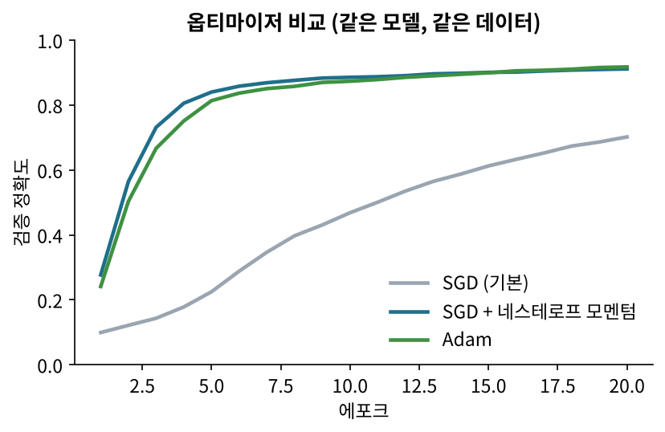
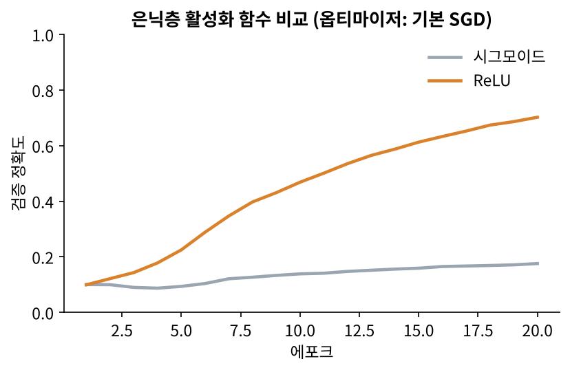
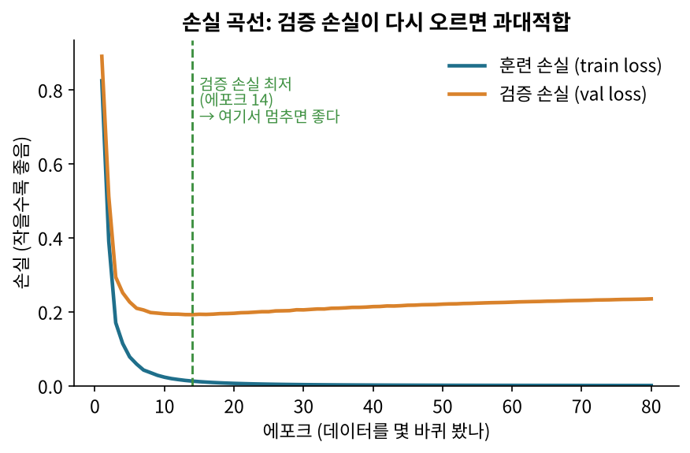

# README

# 혼공머신 7장 딥러닝 정리노트

> 『혼자 공부하는 머신러닝+딥러닝』 7장 공부 기록임.
7-1 인공 신경망 → 7-2 심층 신경망 → 7-3 신경망 모델 훈련 순서로 정리함.
> 
- 코드는 **Keras 3** 문법 기준임 (책이랑 조금 다른 부분은 따로 적어둠)
- 환경: Python 3.13 + TensorFlow (가상환경 `.dl`)
- ✍ 표시는 직접 실행해서 숫자 채우는 칸임
- 파라미터 개수, 데이터 shape은 손으로 계산해서 확인함

## 목차

1. 7-1 인공 신경망
2. 7-2 심층 신경망
3. 7-3 신경망 모델 훈련
4. 응용: 내 데이터에 써먹기
5. 복기: 한 장 요약이랑 복습 계획
6. 퀴즈 20문제

---

## 7-1 인공 신경망

옷 사진 10종류 맞히는 문제임. 먼저 사이킷런으로 풀고, 같은 문제를 케라스 신경망으로 다시 풂.

### 한눈에

- 패션 MNIST 사진을 숫자 표로 바꿈 (÷255, 784칸으로 펴기)
- 4장의 `SGDClassifier`로 먼저 풀어서 기준 점수를 봄
- 같은 문제를 케라스 **Dense 층 1개**짜리 신경망으로 풂 (compile → fit → evaluate)

**앞 장이랑 연결:** 이 신경망은 사실 **4장의 로지스틱 회귀(다중 분류)랑 같은 모델**임. 도구만 사이킷런에서 케라스로 바뀐 거임.

> **비유**
뉴런 10개 = **심사위원 10명**임. 각자 “티셔츠 담당”, “바지 담당”… 이런 식이고, 픽셀 784개를 보고 자기 옷일 점수를 냄.
소프트맥스가 10명 점수를 **득표율(확률)** 로 바꾸고, 제일 높은 쪽이 답이 됨.
> 

### 코드 한 줄씩

#### ① 데이터 불러오기

```python
import keras

(train_input, train_target), (test_input, test_target) = \
    keras.datasets.fashion_mnist.load_data()

print(train_input.shape, train_target.shape)
print(test_input.shape, test_target.shape)
```

```
(60000, 28, 28) (60000,)
(10000, 28, 28) (10000,)
```

- `import keras` : Keras 3에서는 이렇게 바로 가져옴. `from tensorflow import keras`도 같은 거임
- `load_data()` : **(훈련 입력, 훈련 정답), (테스트 입력, 테스트 정답)** 4개로 나눠 받음. 처음 한 번만 내려받고 다음부터는 저장된 파일 씀
- shape = (샘플 수, 세로, 가로) → 28×28 흑백 사진이 6만 장임

| 정답 번호 | 옷 | 정답 번호 | 옷 |
| --- | --- | --- | --- |
| 0 | 티셔츠 | 5 | 샌들 |
| 1 | 바지 | 6 | 셔츠 |
| 2 | 스웨터(풀오버) | 7 | 스니커즈 |
| 3 | 드레스 | 8 | 가방 |
| 4 | 코트 | 9 | 앵클 부츠 |
- 클래스마다 **6,000장씩** 고르게 들어 있음. `np.unique(train_target, return_counts=True)`로 확인 가능함
- 책에 있는 `imshow(…, cmap="gray_r")`의 `gray_r`은 흑백을 뒤집어서 옷이 검게 보이게 하는 거임

#### ② 정규화랑 펴기 + 사이킷런으로 먼저 풀기

```python
train_scaled = train_input / 255.0
train_scaled = train_scaled.reshape(-1, 28*28)

from sklearn.linear_model import SGDClassifier
from sklearn.model_selection import cross_validate
import numpy as np

sc = SGDClassifier(loss="log_loss", max_iter=5, random_state=42)
scores = cross_validate(sc, train_scaled, train_target, n_jobs=-1)
print(np.mean(scores["test_score"]))
```

- `/ 255.0` : 픽셀 0~255를 0~1로 줄임(정규화). 경사 하강법이 안정적으로 움직이게 하려는 거임
- `reshape(-1, 28*28)` : 사진 한 장(28×28)을 784칸 한 줄로 폄. -1은 “개수는 알아서” → (60000, 784)
- `loss="log_loss"` : 로지스틱 회귀를 SGD로 학습한다는 뜻임. 5에포크만 돌림
- `cross_validate` : 5-폴드 교차 검증 평균 정확도. 이 숫자가 신경망이랑 비교할 **기준선**임

> ✍ **직접 실행해서 확인**`np.mean(scores["test_score"])` = 0.____
(ConvergenceWarning은 5에포크로 끊어서 나는 경고라 무시해도 됨)
> 

#### ③ 검증 세트 떼고 케라스 모델 만들기

```python
from sklearn.model_selection import train_test_split
train_scaled, val_scaled, train_target, val_target = train_test_split(
    train_scaled, train_target, test_size=0.2, random_state=42)

model = keras.Sequential([
    keras.Input(shape=(784,)),
    keras.layers.Dense(10, activation="softmax")
])
```

- 훈련 데이터의 20%를 **검증 세트**로 뗌 → 훈련 (48000, 784), 검증 (12000, 784)
- 딥러닝은 학습이 오래 걸려서 교차 검증 대신 검증 세트 하나만 씀
- `Sequential` : 층을 순서대로 쌓는 모델 상자임
- `keras.Input(shape=(784,))` : “샘플 하나는 숫자 784개”라고 알려주는 거임
- `Dense(10, activation="softmax")` : 앞의 모든 입력이랑 연결된 층. 뉴런 10개(클래스 수) + 소프트맥스(확률로 바꾸기). 이게 곧 **출력층**임

> **책이랑 다른 부분 (Keras 3)**
책처럼 `Dense(10, activation="softmax", input_shape=(784,))`로 쓰면 Keras 3에서 경고가 뜸.
돌아가긴 하는데, `keras.Input(shape=(784,))`을 맨 앞에 두는 게 깔끔함.
> 

#### ④ compile → fit → evaluate

```python
model.compile(loss="sparse_categorical_crossentropy",
              metrics=["accuracy"])
model.fit(train_scaled, train_target, epochs=5)
model.evaluate(val_scaled, val_target)
```

- `loss` : 뭘 줄일지 정함. 정답이 0~9 **정수**라서 sparse를 씀
- `metrics` : 학습 중에 보여줄 점수(정확도). Keras 3에서는 **리스트**로 줘야 함
- `fit` : 48,000개를 5바퀴 학습함
- `evaluate` : 검증 세트로 채점. 결과는 **[손실, 정확도]** 두 숫자임

### 실행 결과 읽는 법

fit을 돌리면 에포크마다 이런 줄이 나옴 (숫자는 돌릴 때마다 조금씩 다름).

```
Epoch 1/5
1500/1500 ━━━━━━━━━━━━━━━━━━━━ 3s 2ms/step - accuracy: 0.____ - loss: 0.____
```

| 부분 | 뜻 |
| --- | --- |
| `Epoch 1/5` | 5바퀴 중 1번째 |
| `1500/1500` | 이번 바퀴에서 가중치 고친 횟수 = 48,000 ÷ 32(기본 batch_size) |
| `3s 2ms/step` | 이번 바퀴 걸린 시간 / 한 번 고칠 때 걸린 시간 |
| `accuracy`, `loss` | 이번 바퀴 동안의 훈련 정확도, 훈련 손실 (평균) |

> ✍ **7-1 결과 기록**
5번째 에포크 accuracy: 0.____ / loss: 0._
***evaluate 결과: [손실 0._, 정확도 0._]
→ 사이킷런 기준 점수(0.***_)랑 비교해보기
> 

### 앞 장이랑 연결

|  | 내용 |
| --- | --- |
| 앞에서 배운 것 | 4-1 로지스틱 회귀(다중 분류, 소프트맥스), 4-2 `SGDClassifier(loss="log_loss")`, 5-2 검증 세트·교차 검증 |
| 7-1에서는 | Dense(10, softmax) 1개짜리 신경망 = 다중 분류 로지스틱 회귀. 케라스는 미니배치(32개)로 학습함 |
| 같은 점 | 선형 계산 + 소프트맥스 + 크로스엔트로피 손실 + 경사 하강법. 이론상 같은 모델임 |
| 다른 점 | 사이킷런은 모델 만들 때 손실을 정하는데, 케라스는 **compile**에서 따로 정함. 사이킷런 score는 정확도 하나, 케라스 evaluate는 [손실, 정확도] |

### 자주 하는 실수랑 에러

| 증상 · 에러 | 원인 | 해결 |
| --- | --- | --- |
| `ModuleNotFoundError: No module named 'keras'` | TensorFlow 없는 파이썬(예: 3.15) 커널임 | 노트북 오른쪽 위 커널을 딥러닝 가상환경으로 바꿈 |
| `Expected `metrics` argument to be a list ...` | `metrics="accuracy"`처럼 문자열 하나로 줌 | `metrics=["accuracy"]` |
| 입력 모양이 안 맞는다는 ValueError | reshape 안 해서 (28, 28)이 들어감 | `reshape(-1, 28*28)` 또는 Flatten 층(7-2) |
| 손실이 이상하게 크거나 모양 에러 | 정수 정답인데 `categorical_crossentropy` 씀 | `sparse_categorical_crossentropy` |
| 정확도가 매번 조금씩 다름 | 가중치 시작값이 무작위임 | 정상임. 고정하려면 `keras.utils.set_random_seed(42)` |

### 응용: 바꿔보기 실험

사이킷런 신경망(`MLPClassifier`)으로 **8×8 숫자 손글씨 사진**(훈련 400장, 검증 719장)에 같은 실험을 돌려봄. 3번씩 돌린 평균임.
케라스 + 패션 MNIST에서도 경향은 비슷할 거임.

| 바꿀 것 | 예상 | 작은 데이터 실제 결과 | 왜 그런지 |
| --- | --- | --- | --- |
| 에포크 5 → 20 | 오를 것 같음 | 검증 정확도 0.814 → **0.917** | 아직 덜 배웠으면 더 돌릴수록 오름. 근데 너무 많이 돌리면 과대적합(7-3) |
| 선형 모델 → 은닉층 있는 신경망 | 오를 것 같음 | SGDClassifier 0.861 → 은닉층 100개 0.917 | 은닉층이 있으면 픽셀을 조합한 “특징”을 스스로 만듦 (7-2) |

### 덮고 답하기

답을 먼저 말해보고 눌러서 확인하기.

- Q1. 신경망에 넣기 전에 사진에 하는 전처리 두 가지는?
    
    **÷255 정규화**
    
    **reshape(-1, 784)**
    
- Q2. 출력층이 Dense(10, activation=“softmax”)인 이유는?
- Q3. loss에 sparse_categorical_crossentropy를 쓰는 이유는?
    
    **정수**
    

**빈칸 코드 채우기**

```python
model = keras.Sequential([
    keras.Input(shape=(____,)),
    keras.layers.Dense(____, activation="____")
])
model.compile(loss="____", metrics=["accuracy"])
model.fit(train_scaled, train_target, ____=5)
```

- 정답 보기
    
    ```python
    model = keras.Sequential([
        keras.Input(shape=(784,)),
        keras.layers.Dense(10, activation="softmax")
    ])
    model.compile(loss="sparse_categorical_crossentropy", metrics=["accuracy"])
    model.fit(train_scaled, train_target, epochs=5)
    ```
    

### ⏱ 1분 복기 카드 · 7-1

1. Dense(10, softmax) 하나 = 다중 분류 로지스틱 회귀임
2. 케라스 순서: Sequential → compile → fit → evaluate
3. 정수 정답이면 sparse_categorical_crossentropy, evaluate는 [손실, 정확도]

---

## 7-2 심층 신경망

층을 하나 더 쌓고, 활성화 함수랑 옵티마이저를 바꿔서 성능을 올림.

### 한눈에

- 입력층이랑 출력층 사이에 **은닉층**(뉴런 100개)을 넣음 → 진짜 “딥”러닝
- 은닉층 활성화 함수를 시그모이드에서 **ReLU**로 바꾸고, 784로 펴는 일은 **Flatten 층**한테 맡김
- **옵티마이저**(가중치 고치는 방법)랑 학습률을 바꿔봄

**앞 절이랑 연결:** 7-1 모델은 출력층 하나뿐이라 픽셀을 그대로 보고 답했음. 7-2는 중간에 은닉층을 넣어서, 픽셀을 조합한 “특징”을 먼저 만들고 그걸로 답함.

> **비유**
7-1이 심사위원 10명이 사진을 바로 보고 투표하는 방식이면, 7-2는 그 앞에 **분석가 100명(은닉층)** 을 둔 거임.
분석가들이 “목이 둥글다”, “다리가 둘이다” 같은 특징 점수를 먼저 내고, 심사위원은 그 특징을 보고 투표함.
> 

### 코드 한 줄씩

#### ① 은닉층이 있는 모델

```python
dense1 = keras.layers.Dense(100, activation="sigmoid")
dense2 = keras.layers.Dense(10, activation="softmax")
model = keras.Sequential([keras.Input(shape=(784,)), dense1, dense2])
model.summary()
```

```
Layer (type)            Output Shape          Param #
─────────────────────────────────────────────────────
dense (Dense)           (None, 100)            78,500
dense_1 (Dense)         (None, 10)              1,010
─────────────────────────────────────────────────────
Total params: 79,510
Trainable params: 79,510
Non-trainable params: 0
```

- `dense1` : **은닉층**. 뉴런 100개. 개수는 정답이 없는 하이퍼파라미터임. 보통 출력층(10)보다는 많게 잡음
- `dense2` : **출력층**. 7-1이랑 같음
- 쌓은 순서가 곧 계산 순서임 (입력 → 은닉층 → 출력층)

**파라미터 계산**

```
파라미터 = 입력 수 × 뉴런 수 + 뉴런 수(절편)
은닉층: 784 × 100 + 100 = 78,500
출력층: 100 × 10 + 10   =  1,010     ← 출력층의 입력은 은닉층 뉴런 100개
합계:                      79,510
```

| summary 부분 | 뜻 |
| --- | --- |
| `dense`, `dense_1` | 층 이름. 자동으로 붙음 (번호는 달라질 수 있음) |
| `(None, 100)` | None = 샘플 개수(배치 크기)는 안 정해짐. 100 = 이 층이 내보내는 숫자 개수 |
| `Param #` | 그 층의 가중치 + 절편 개수 |
| `Trainable params` | 학습으로 바뀌는 파라미터 수 |

#### ② Flatten + ReLU + add()

reshape 안 하고 ÷255만 한 (48000, 28, 28) 데이터를 씀. (책은 여기서 데이터를 다시 불러와서 나눔)

```python
model = keras.Sequential()
model.add(keras.Input(shape=(28, 28)))
model.add(keras.layers.Flatten())
model.add(keras.layers.Dense(100, activation="relu"))
model.add(keras.layers.Dense(10, activation="softmax"))

model.compile(loss="sparse_categorical_crossentropy", metrics=["accuracy"])
model.fit(train_scaled, train_target, epochs=5)
```

- `Flatten` : 28×28을 784칸으로 펴주는 층임. 계산을 안 해서 파라미터 0개. reshape를 모델 안으로 옮긴 거임
- `relu` : 음수는 0, 양수는 그대로. 시그모이드보다 계산이 단순하고, 층이 깊어져도 학습이 잘 됨
- `model.add()` : 층을 하나씩 뒤에 붙이는 방법임. 리스트로 한 번에 넣는 거랑 결과 같음
- 옵티마이저를 안 적으면 기본값 **rmsprop**이 쓰임
- 이 모델 summary: flatten (None, 784) 0개 → dense (None, 100) 78,500개 → dense (None, 10) 1,010개. 합계는 ①이랑 같은 79,510개임

#### ③ 옵티마이저 바꾸기

```python
# 이름(문자열)으로 고르면 기본 설정이 쓰임. SGD 기본 학습률은 0.01
model.compile(optimizer="sgd", loss="sparse_categorical_crossentropy", metrics=["accuracy"])

# 객체로 만들면 학습률 같은 세부 설정을 바꿀 수 있음
sgd = keras.optimizers.SGD(learning_rate=0.1)
sgd = keras.optimizers.SGD(momentum=0.9, nesterov=True)

adagrad = keras.optimizers.Adagrad()
rmsprop = keras.optimizers.RMSprop()

model.compile(optimizer="adam", loss="sparse_categorical_crossentropy", metrics=["accuracy"])
```

| 옵티마이저 | 한 줄 특징 | 비유 |
| --- | --- | --- |
| SGD | 기울기 반대로 일정한 걸음 | 같은 보폭으로 걷기 |
| SGD + 모멘텀 · 네스테로프 | 가던 방향의 관성을 더함 | 내리막에서 굴러가는 공 |
| Adagrad · RMSprop | 가중치마다 걸음 크기 자동 조절 (기본 학습률 0.001) | 길이 험하면 보폭 줄이는 등산객 |
| Adam | 관성 + 걸음 자동 조절 (기본 학습률 0.001) | 굴러가는 공 + 똑똑한 브레이크 |
- 네스테로프 = 관성으로 갈 곳을 미리 보고 고치는 개선판임
- 뭘 쓸지 모르겠으면 일단 **adam**이 제일 무난함

옵티마이저별 검증 정확도 곡선



옵티마이저별 검증 정확도 곡선

사이킷런 신경망으로 작은 숫자 사진 데이터에 실험한 결과임 (3번 평균). 20에포크 후: SGD 0.702, 네스테로프 0.911, Adam 0.917.

### 실행 결과 읽는 법

> ✍ **7-2 결과 기록**
sigmoid 은닉층 모델 5에포크 evaluate: 정확도 0._
***relu + Flatten 모델 5에포크 evaluate: 정확도 0.***_
adam으로 바꾼 모델 evaluate: 정확도 0.____
→ 7-1(층 1개)보다 올랐는지 비교하기
> 

### 앞 장이랑 연결

|  | 내용 |
| --- | --- |
| 앞에서 배운 것 | 4-1 시그모이드, 4-2 SGD랑 학습률(개념), 3-3 규제 |
| 7-2에서는 | 시그모이드를 출력층 말고 **은닉층**에도 쓰고, 이어서 ReLU로 바꿈. SGD 말고도 여러 옵티마이저를 고를 수 있음 |
| 같은 점 | 경사 하강법으로 손실을 줄인다는 원리는 그대로임 |
| 다른 점 | 모델이 “특징을 스스로 만드는” 층이 생김. 파라미터가 7,850개 → 79,510개로 10배 늘어남 |

### 자주 하는 실수랑 에러

| 증상 · 에러 | 원인 | 해결 |
| --- | --- | --- |
| 입력 모양 에러 (784 vs 28, 28) | Flatten 모델에 reshape한 데이터를 넣거나 그 반대임 | Flatten 쓰면 (28, 28) 그대로, 안 쓰면 784로 펴서 넣음 |
| 정확도가 거의 안 오름 (0.1 근처) | 학습률이 너무 크거나 작음. 또는 sigmoid + 기본 SGD라 너무 느림 | adam으로 바꾸거나 학습률 조정 |
| `Unknown optimizer` | 이름 오타 (예: `"Adam "` 공백, `"adm"`) | `"adam"`, `"sgd"`, `"rmsprop"`, `"adagrad"` |
| summary()에 Output Shape가 이상함 | Input을 안 넣어서 모델이 아직 모양을 모름 | 맨 앞에 `keras.Input(shape=…)` |

### 응용: 바꿔보기 실험

같은 작은 데이터 실험임 (사이킷런 신경망, 3번 평균).

| 바꿀 것 | 예상 | 작은 데이터 실제 결과 | 왜 그런지 |
| --- | --- | --- | --- |
| 은닉층 활성화: 시그모이드 → ReLU | 비슷할 것 같음 | 20에포크 후 0.176 → **0.702** (기본 SGD) | 시그모이드는 끝부분 기울기가 작아서 학습이 느림. ReLU는 양수 쪽 기울기가 항상 1이라 잘 배움 |
| 뉴런 100 → 300 | 오를 것 같음 | 0.917 → 0.938 | 특징을 더 많이 만들 수 있음. 대신 파라미터가 늘어서 느려지고 과대적합 위험도 커짐 |
| 은닉층 1개 → 2개 (100, 100) | 오를 것 같음 | 0.917 → 0.94 | 특징의 특징을 만듦. 데이터가 작으면 효과가 작거나 오히려 과대적합할 수 있음 |
| 옵티마이저 SGD → Adam | 빨라질 것 같음 | 0.702 → **0.917** | 걸음 크기를 자동으로 조절해서 같은 에포크에 훨씬 멀리 감 |

시그모이드랑 ReLU의 검증 정확도 곡선



시그모이드랑 ReLU의 검증 정확도 곡선

### 덮고 답하기

- Q1. 은닉층 Dense(100)이 784개 입력을 받을 때 파라미터 수는?
    
    **78,500**
    
- Q2. Flatten 층은 무슨 일을 하고, 파라미터는 몇 개?
    
    **0개**
    
- Q3. 은닉층에 시그모이드 대신 ReLU를 쓰는 이유는?

**빈칸 코드 채우기**

```python
model = keras.Sequential()
model.add(keras.Input(shape=(28, 28)))
model.add(keras.layers.____())
model.add(keras.layers.Dense(100, activation="____"))
model.add(keras.layers.Dense(10, activation="softmax"))
model.compile(optimizer="____", loss="sparse_categorical_crossentropy", metrics=["accuracy"])
```

- 정답 보기
    
    ```python
    model = keras.Sequential()
    model.add(keras.Input(shape=(28, 28)))
    model.add(keras.layers.Flatten())
    model.add(keras.layers.Dense(100, activation="relu"))
    model.add(keras.layers.Dense(10, activation="softmax"))
    model.compile(optimizer="adam", loss="sparse_categorical_crossentropy", metrics=["accuracy"])
    ```
    

### ⏱ 1분 복기 카드 · 7-2

1. 은닉층 = 특징을 만드는 중간 층. 파라미터 = 입력 × 뉴런 + 뉴런
2. 은닉층은 ReLU, 출력층은 소프트맥스. Flatten은 펴기만 함 (파라미터 0)
3. 옵티마이저: 기본은 rmsprop, 무난한 선택은 adam (학습률 0.001)

---

## 7-3 신경망 모델 훈련

손실 곡선으로 과대적합을 보고, 드롭아웃·저장·콜백으로 제일 좋은 모델을 지킴.

### 한눈에

- fit이 돌려주는 **history**로 에포크별 훈련·검증 손실 그래프를 그림
- **드롭아웃**으로 과대적합을 줄이고, 모델을 **저장·복원**함
- **콜백**으로 제일 좋은 모델을 자동 저장하고, 나빠지면 자동으로 멈춤 (조기 종료)

**앞 절이랑 연결:** 7-2에서 모델을 키웠더니 성능이 올랐음. 근데 오래 학습하면 훈련 데이터를 외우기 시작함. 7-3은 “언제 멈추고 뭘 남길지”를 다룸.

> **비유**
> 
> - **history** = 매일 쓰는 공부 일지
> - **드롭아웃** = 매번 팀원 몇 명이 랜덤으로 빠져서, 결국 모두가 전체를 알게 되는 팀 과제
> - **ModelCheckpoint** = 모의고사 최고점 찍을 때마다 답안지 복사해두기
> - **EarlyStopping** = 모의고사 점수가 2번 연속 안 오르면 공부 멈추고 최고점 답안지로 돌아가기

### 코드 한 줄씩

#### ① 모델 만드는 함수랑 history

```python
def model_fn(a_layer=None):
    model = keras.Sequential()
    model.add(keras.Input(shape=(28, 28)))
    model.add(keras.layers.Flatten())
    model.add(keras.layers.Dense(100, activation="relu"))
    if a_layer:
        model.add(a_layer)
    model.add(keras.layers.Dense(10, activation="softmax"))
    return model

model = model_fn()
model.compile(loss="sparse_categorical_crossentropy", metrics=["accuracy"])
history = model.fit(train_scaled, train_target, epochs=5, verbose=0)
print(history.history.keys())
```

- `model_fn` : 같은 모델을 여러 번 만들기 쉽게 함수로 묶은 거임
- `a_layer` : 층을 넘기면 은닉층 뒤에 끼워 넣음 (예: 드롭아웃). 기본값 None = 안 끼움
- **fit의 결과를 history에 받음.** 이게 핵심임
- `verbose=0` : 진행 막대를 숨김 (1 = 막대, 2 = 에포크마다 한 줄)
- 기록되는 항목: accuracy, loss. `validation_data`를 주면 val_accuracy, val_loss도 생김

#### ② 손실 곡선 그리기

```python
model = model_fn()
model.compile(optimizer="adam", loss="sparse_categorical_crossentropy", metrics=["accuracy"])
history = model.fit(train_scaled, train_target, epochs=20, verbose=0,
                    validation_data=(val_scaled, val_target))

import matplotlib.pyplot as plt
plt.plot(history.history["loss"])
plt.plot(history.history["val_loss"])
plt.xlabel("epoch"); plt.ylabel("loss")
plt.legend(["train", "val"])
plt.show()
```

- `validation_data`를 줘야 에포크마다 검증 세트 손실·정확도가 기록됨
- 훈련 손실이랑 검증 손실을 겹쳐서 그림

훈련 손실이랑 검증 손실 곡선



훈련 손실이랑 검증 손실 곡선

같은 원리를 사이킷런 신경망으로 학습해서 그린 실제 곡선임 (숫자 손글씨). 검증 손실이 14에포크에서 제일 낮고 그 뒤로 다시 오름.

| 곡선 모양 | 뜻 | 할 일 |
| --- | --- | --- |
| 둘 다 내려감 | 아직 잘 배우는 중 | 계속 학습 |
| 훈련 ↓, 검증 ↑ | **과대적합 시작** | 그 직전 에포크에서 멈추기, 드롭아웃 |
| 둘 다 높게 평평 | 과소적합 | 층·뉴런 늘리기, 더 오래 학습 |

#### ③ 드롭아웃

```python
model = model_fn(keras.layers.Dropout(0.3))
model.summary()
model.compile(optimizer="adam", loss="sparse_categorical_crossentropy", metrics=["accuracy"])
history = model.fit(train_scaled, train_target, epochs=20, verbose=0,
                    validation_data=(val_scaled, val_target))
```

- `Dropout(0.3)` : 학습할 때 은닉층 출력의 30%를 무작위로 0으로 만듦
- summary에 dropout 층이 추가되는데 파라미터는 0개임. 전체는 79,510개 그대로
- **드롭아웃은 학습할 때만 켜짐.** evaluate나 predict 할 때는 케라스가 알아서 끄고 모든 뉴런을 씀. 따로 신경 안 써도 됨

#### ④ 저장이랑 복원

```python
model.save_weights("model.weights.h5")     # 가중치만
model.save("model-whole.keras")            # 모델 전체

# 가중치만 저장했으면: 같은 구조를 먼저 만들고 불러옴
model = model_fn(keras.layers.Dropout(0.3))
model.load_weights("model.weights.h5")

import numpy as np
val_labels = np.argmax(model.predict(val_scaled), axis=-1)
print(np.mean(val_labels == val_target))

# 전체를 저장했으면: 바로 불러와서 씀
model = keras.models.load_model("model-whole.keras")
model.evaluate(val_scaled, val_target)
```

- `save_weights` : **가중치만** 저장. Keras 3에서는 파일 이름이 꼭 `.weights.h5`로 끝나야 함
- `save` : **모델 전체**(구조 + 가중치 + 설정) 저장. 확장자 `.keras`
- `predict`는 확률 10개를 줌. `argmax`로 제일 큰 확률의 위치(클래스)를 고르고, 정답이랑 같은 비율 = 정확도임

#### ⑤ 콜백: ModelCheckpoint + EarlyStopping

```python
model = model_fn(keras.layers.Dropout(0.3))
model.compile(optimizer="adam", loss="sparse_categorical_crossentropy", metrics=["accuracy"])

checkpoint_cb = keras.callbacks.ModelCheckpoint("best-model.keras", save_best_only=True)
early_stopping_cb = keras.callbacks.EarlyStopping(patience=2, restore_best_weights=True)

history = model.fit(train_scaled, train_target, epochs=20, verbose=0,
                    validation_data=(val_scaled, val_target),
                    callbacks=[checkpoint_cb, early_stopping_cb])
print(early_stopping_cb.stopped_epoch)
```

- `ModelCheckpoint(save_best_only=True)` : 에포크마다 검증 손실을 보고, **지금까지 중 제일 좋을 때만** 파일로 저장함
- `patience=2` : 검증 손실이 2에포크 연속 안 나아지면 멈춤
- `restore_best_weights=True` : 멈출 때 제일 좋았던 가중치로 되돌림
- 콜백은 기본으로 val_loss를 보고 판단함 → 그래서 `validation_data`가 꼭 필요함
- `stopped_epoch` : 몇 번째 에포크에서 멈췄는지 (0부터 셈). 10이면 11번째 에포크에서 멈춘 거고, 최고는 그 2에포크 전임

> ✍ **7-3 결과 기록**
드롭아웃 없을 때 검증 손실이 제일 낮았던 에포크: ____
드롭아웃 0.3일 때: ____ (곡선이 덜 벌어졌나? **)
`early_stopping_cb.stopped_epoch` =** __
최종 evaluate: [손실 0._***, 정확도 0.***_]
> 

### 앞 장이랑 연결

|  | 내용 |
| --- | --- |
| 앞에서 배운 것 | 3-1 과대적합, 4-2 에포크랑 조기 종료(개념), 5-1 결정 트리 깊이 제한, 5-3 랜덤 포레스트의 무작위성 |
| 7-3에서는 | 손실 곡선으로 과대적합을 보고, 드롭아웃·EarlyStopping 콜백으로 막음 |
| 같은 점 | “훈련은 좋은데 새 데이터는 나쁘다”를 막는 목적이 같음 |
| 다른 점 | 드롭아웃은 신경망 전용임. 조기 종료가 4-2에서는 개념이었는데 여기서는 콜백 한 줄로 자동화됨. 모델 저장(.keras)도 새로 나옴 |

### 자주 하는 실수랑 에러

| 증상 · 에러 | 원인 | 해결 |
| --- | --- | --- |
| `save_weights`에서 ValueError (파일 이름) | Keras 3는 `.weights.h5`로 끝나야 함 | `"model.weights.h5"` |
| `model.save("model")`에서 ValueError | 확장자 없음 | `"model.keras"` |
| load_weights에서 모양이 안 맞는다는 에러 | 저장할 때랑 다른 구조의 모델에 불러옴 | 같은 model_fn(같은 층)으로 만든 다음 불러오기 |
| `history.history["val_loss"]`에서 KeyError | fit에 validation_data를 안 줌 | `validation_data=(val_scaled, val_target)` |
| predict 결과로 정확도를 바로 계산했더니 이상함 | predict는 확률(10개)을 줌 | `np.argmax(…, axis=-1)`로 클래스 고르기 |

### 응용: 바꿔보기 실험

드롭아웃이랑 콜백은 사이킷런 신경망에 없어서 작은 데이터로 대신 실험 못 함. 케라스에서 직접 돌려서 채울 거임. 예상 칸은 원리로 적어둠.

| 바꿀 것 | 예상 | 실제 결과 (✍ 직접 기록) | 왜 그런지 |
| --- | --- | --- | --- |
| Dropout 0.3 → 0.5 | 훈련 손실은 조금 높아지고, 두 곡선 사이가 더 좁아질 것 같음 | ____ | 더 많이 끌수록 외우기 어려워짐. 너무 크면 과소적합 |
| patience 2 → 5 | 더 늦게 멈출 것 같음 | stopped_epoch = ____ | 더 오래 기다려줌. restore_best_weights 덕분에 최종 성능은 비슷할 수 있음 |
| epochs 20 → 50 (콜백 사용) | 20보다 훨씬 전에 멈출 것 같음 | stopped_epoch = ____ | 조기 종료가 있으면 에포크를 넉넉히 줘도 알아서 멈춤 |

### 덮고 답하기

- Q1. 훈련 손실은 계속 내려가는데 검증 손실이 다시 오르면 무슨 뜻이고, 뭘 해야 함?
    
    **과대적합**
    
- Q2. save_weights랑 save의 차이는?
    - save_weights : **가중치만**(.weights.h5) → 같은 구조를 먼저 만들고 불러와야 함
    - save : **모델 전체**(.keras) → load_model로 바로 씀
- Q3. EarlyStopping(patience=2, restore_best_weights=True)의 두 설정 뜻은?
    - patience=2 : 검증 손실이 2에포크 연속 안 좋아지면 멈춤
    - restore_best_weights=True : 멈춘 다음 제일 좋았던 가중치로 되돌림

**빈칸 코드 채우기**

```python
checkpoint_cb = keras.callbacks.ModelCheckpoint("best-model.keras", save_best_only=____)
early_stopping_cb = keras.callbacks.EarlyStopping(patience=____, restore_best_weights=True)
history = model.fit(train_scaled, train_target, epochs=20,
                    validation_data=(____, ____),
                    callbacks=[checkpoint_cb, early_stopping_cb])
```

- 정답 보기
    
    ```python
    checkpoint_cb = keras.callbacks.ModelCheckpoint("best-model.keras", save_best_only=True)
    early_stopping_cb = keras.callbacks.EarlyStopping(patience=2, restore_best_weights=True)
    history = model.fit(train_scaled, train_target, epochs=20,
                        validation_data=(val_scaled, val_target),
                        callbacks=[checkpoint_cb, early_stopping_cb])
    ```
    

### ⏱ 1분 복기 카드 · 7-3

1. 판단은 항상 검증 손실로 함. 훈련 ↓ 검증 ↑ = 과대적합
2. 드롭아웃은 학습할 때만 일부 뉴런을 끔 (파라미터 0개)
3. 저장: 가중치 `.weights.h5` / 전체 `.keras`. 콜백: 최고 모델 저장 + 조기 종료

---

## 응용: 내 데이터에 써먹기

7장 코드를 그대로 가져다가 다른 문제에 쓰는 법임.

### 복사해서 쓰는 템플릿 (7장 전체를 하나로)

데이터 준비 → 모델 → compile → 콜백 → fit → 손실 곡선 → evaluate → 저장 순서임. 주석 번호가 곧 7장 흐름임.

```python
import keras
import numpy as np
import matplotlib.pyplot as plt
from sklearn.model_selection import train_test_split

# 1. 데이터 준비 ─────────────────────────────
(train_input, train_target), (test_input, test_target) = keras.datasets.fashion_mnist.load_data()
train_scaled = train_input / 255.0                       # 0~1로 정규화
test_scaled = test_input / 255.0
train_scaled, val_scaled, train_target, val_target = train_test_split(
    train_scaled, train_target, test_size=0.2, random_state=42)

# 2. 모델 ────────────────────────────────────
model = keras.Sequential([
    keras.Input(shape=(28, 28)),
    keras.layers.Flatten(),
    keras.layers.Dense(100, activation="relu"),
    keras.layers.Dropout(0.3),
    keras.layers.Dense(10, activation="softmax"),
])
model.summary()

# 3. compile ─────────────────────────────────
model.compile(optimizer="adam",
              loss="sparse_categorical_crossentropy",
              metrics=["accuracy"])

# 4. 콜백 ────────────────────────────────────
checkpoint_cb = keras.callbacks.ModelCheckpoint("best-model.keras", save_best_only=True)
early_stopping_cb = keras.callbacks.EarlyStopping(patience=2, restore_best_weights=True)

# 5. fit ─────────────────────────────────────
history = model.fit(train_scaled, train_target, epochs=20,
                    validation_data=(val_scaled, val_target),
                    callbacks=[checkpoint_cb, early_stopping_cb])
print("멈춘 에포크:", early_stopping_cb.stopped_epoch)

# 6. 손실 곡선 ───────────────────────────────
plt.plot(history.history["loss"], label="train")
plt.plot(history.history["val_loss"], label="val")
plt.xlabel("epoch"); plt.ylabel("loss"); plt.legend(); plt.show()

# 7. 평가 (테스트 세트는 마지막에 한 번) ─────
model.evaluate(test_scaled, test_target)

# 8. 저장 · 불러오기 ─────────────────────────
model.save("model-whole.keras")
loaded = keras.models.load_model("model-whole.keras")
pred = np.argmax(loaded.predict(test_scaled[:5]), axis=-1)
print(pred, test_target[:5])
```

### 다른 데이터에 적용: 손글씨 숫자 (MNIST)

MNIST는 패션 MNIST랑 모양(28×28, 흑백, 10클래스)이 똑같음. 그래서 **데이터 불러오는 한 줄만** 바꾸면 됨.

```python
import keras
import numpy as np
from sklearn.model_selection import train_test_split

(train_input, train_target), (test_input, test_target) = keras.datasets.mnist.load_data()   # ← 바뀐 부분: fashion_mnist → mnist
train_scaled = train_input / 255.0
test_scaled = test_input / 255.0
train_scaled, val_scaled, train_target, val_target = train_test_split(
    train_scaled, train_target, test_size=0.2, random_state=42)

model = keras.Sequential([
    keras.Input(shape=(28, 28)),          # 손글씨 숫자도 28×28 흑백이라 그대로
    keras.layers.Flatten(),
    keras.layers.Dense(100, activation="relu"),
    keras.layers.Dropout(0.3),
    keras.layers.Dense(10, activation="softmax"),   # 숫자도 0~9, 10개라 그대로
])
model.compile(optimizer="adam", loss="sparse_categorical_crossentropy", metrics=["accuracy"])
early_stopping_cb = keras.callbacks.EarlyStopping(patience=2, restore_best_weights=True)
model.fit(train_scaled, train_target, epochs=20,
          validation_data=(val_scaled, val_target), callbacks=[early_stopping_cb])
model.evaluate(test_scaled, test_target)
```

### 내 데이터에 쓸 때 체크리스트

| 문제 종류 | 출력층 | 손실 함수 | metrics |
| --- | --- | --- | --- |
| **이진 분류** (예/아니오, 이탈/유지) | `Dense(1, activation="sigmoid")` | `binary_crossentropy` | `["accuracy"]` |
| **다중 분류**, 정답이 정수 (0, 1, 2 …) | `Dense(클래스 수, activation="softmax")` | `sparse_categorical_crossentropy` | `["accuracy"]` |
| **다중 분류**, 정답이 원-핫 | `Dense(클래스 수, activation="softmax")` | `categorical_crossentropy` | `["accuracy"]` |
| **회귀** (가격, 연비 같은 숫자) | `Dense(1)` (활성화 없음) | `mse` | `["mae"]` |
- [ ]  **입력 모양** : 샘플 하나가 숫자 몇 개인지? 사진이면 Flatten, 표 데이터면 `Input(shape=(특성 수,))`
- [ ]  **정규화** : 숫자 범위가 제각각인지? 사진은 ÷255, 표 데이터는 StandardScaler
- [ ]  **글자 열** : 글자로 된 열이 있는지? 원-핫 인코딩으로 숫자로 바꿈
- [ ]  **검증 세트** : 검증 세트 뗐는지? (EarlyStopping에 필요함)
- [ ]  **테스트 세트** : 마지막에 한 번만 쓰는지?

> **예: 통신사 고객 이탈 데이터라면**
전처리(45열) 거친 다음 `keras.Input(shape=(45,))` → `Dense(…, relu)` → **`Dense(1, sigmoid)`** + **`binary_crossentropy`** 쓰면 됨. 이진 분류라서 그럼.
> 

---

## 복기: 한 장 요약이랑 복습 계획

시간 지나서 다시 볼 때는 여기부터 보면 됨.

### 7장 한 장 요약

**7-1 인공 신경망**

| 단계 | 코드 |
| --- | --- |
| 데이터 준비 (사진 → 0~1 → 784칸 한 줄) | `train_scaled = train_input / 255.0`
`train_scaled = train_scaled.reshape(-1, 28*28)` |
| 검증 세트 떼기 (48,000 / 12,000) | `train_test_split(..., test_size=0.2)` |
| 모델 = 층 쌓기 (출력층 10개 + 소프트맥스) | `keras.Sequential([keras.Input(shape=(784,)), keras.layers.Dense(10, activation="softmax")])` |
| 설정 (손실 함수 + 보여줄 점수) | `model.compile(loss="sparse_categorical_crossentropy", metrics=["accuracy"])` |
| 학습 → 평가 | `model.fit(X, y, epochs=5)`
`model.evaluate(X_val, y_val)` |

**7-2 심층 신경망**

| 단계 | 코드 |
| --- | --- |
| 은닉층 추가 + ReLU + Flatten | `keras.layers.Flatten()`
`keras.layers.Dense(100, activation="relu")` |
| 구조 확인 (파라미터 개수) | `model.summary()` → 78,500 + 1,010 = 79,510 |
| 옵티마이저 고르기 | `model.compile(optimizer="adam", ...)` |

**7-3 신경망 모델 훈련**

| 단계 | 코드 |
| --- | --- |
| 손실 곡선 (훈련 vs 검증) | `history = model.fit(..., validation_data=(X_val, y_val))`
`history.history["val_loss"]` |
| 과대적합 막기 | `keras.layers.Dropout(0.3)` |
| 저장 · 복원 | `model.save("model-whole.keras")`
`keras.models.load_model("model-whole.keras")` |
| 콜백 (최고 모델 저장 + 조기 종료) | `ModelCheckpoint("best-model.keras", save_best_only=True)`
`EarlyStopping(patience=2, restore_best_weights=True)` |

### 복습 계획표

| 언제 | 뭘 | 얼마나 |
| --- | --- | --- |
| 오늘 (처음) | 노트 전체 + 직접 실행해서 ✍ 칸 채우기 + 퀴즈 | 1~2시간 |
| 1일 후 | 한 장 요약만 보고 각 단계 코드 한 줄씩 입으로 말하기 → 1분 복기 카드 3장 | 10분 |
| 3일 후 | 각 절 “덮고 답하기” 9문제 + 빈칸 코드 3개를 노트 안 보고 풀기 | 20분 |
| 7일 후 | 템플릿 코드를 안 보고 빈 파일에 처음부터 써보기 → MNIST로 실행 → 퀴즈 다시 풀기 | 30분 |

---

## 퀴즈 20문제

20개 다 맞히면 7장은 이해한 거임. 답은 눌러서 확인.

### 7-1 (1~7번)

**1. 패션 MNIST 훈련 입력의 shape `(60000, 28, 28)` 설명으로 맞는 건?**

- 784장의 사진이 60,000픽셀씩
- 클래스가 28개
- 28×28 픽셀 흑백 사진이 60,000장
- 컬러 사진 28장
- 정답
    
    **28×28 픽셀 흑백 사진이 60,000장.** shape = (샘플 수, 세로, 가로)임.
    
    - 784는 28×28을 편 다음의 특성 수임
    - 클래스는 10개(정답 0~9)임
    - 채널 차원이 없으니까 흑백이고, 6만 장임

**2. `train_scaled.reshape(-1, 28*28)`을 하는 이유는?**

- 픽셀 값을 0~1로 바꾸려고
- Dense 층은 숫자 한 줄을 입력으로 받아서 사진을 784칸으로 펴야 함
- 검증 세트를 만들려고
- 사진 크기를 절반으로 줄이려고
- 정답
    
    **Dense 층은 숫자 한 줄을 입력으로 받아서 사진을 784칸으로 펴야 함.** Flatten 층을 쓰면 이걸 모델 안에서 대신 해줌(7-2).
    
    - 0~1로 바꾸는 건 ÷255가 하는 일임
    - 검증 세트는 train_test_split으로 만듦
    - 개수는 그대로 784개임. 모양만 바뀜

**3. 딥러닝에서 교차 검증 대신 검증 세트 하나를 떼서 쓰는 주된 이유는?**

- 케라스는 교차 검증을 못 해서
- 교차 검증은 분류에 못 써서
- 검증 세트가 테스트 세트보다 정확해서
- 학습이 오래 걸려서 여러 번 반복하는 교차 검증이 부담스럽고, 데이터가 충분히 많아서
- 정답
    
    **학습이 오래 걸리고 데이터가 충분히 많아서.** 6만 개 중에 1만 2천 개만 떼도 검증하기 충분함.
    
    - 케라스로도 할 수는 있음. 비용 문제임
    - 교차 검증은 5장에서 분류에 썼음
    - 검증 세트랑 테스트 세트는 역할이 다른 거임

**4. `Dense(10, activation="softmax")` 하나만 있는 7-1 모델은 앞에서 배운 어떤 모델이랑 같음?**

- 다중 분류 로지스틱 회귀
- 결정 트리
- 랜덤 포레스트
- k-최근접 이웃
- 정답
    
    **다중 분류 로지스틱 회귀.** 선형 계산 + 소프트맥스 + 크로스엔트로피. 4장이랑 같은 모델임.
    
    - 결정 트리는 질문으로 나누는 방식임
    - 랜덤 포레스트는 트리 앙상블임
    - k-최근접 이웃은 가중치를 학습하지 않음

**5. 정답이 0~9 정수일 때 compile의 loss로 맞는 건?**

- mse
- categorical_crossentropy
- sparse_categorical_crossentropy
- binary_crossentropy
- 정답
    
    **sparse_categorical_crossentropy.** sparse = 정수 정답임.
    
    - mse는 회귀용임
    - categorical_crossentropy는 정답이 원-핫일 때 씀
    - binary_crossentropy는 이진 분류용임

**6. fit 진행 막대의 `1500/1500`이 뜻하는 건? (훈련 48,000개, batch_size 기본값)**

- 맞힌 샘플 수
- 한 에포크에서 가중치를 고친 횟수
- 에포크 수
- 뉴런 수
- 정답
    
    **한 에포크에서 가중치를 고친 횟수.** 48,000 ÷ 32 = 1,500임. 기본 batch_size가 32임.
    
    - 정확도랑 상관없는 횟수임
    - 에포크는 `Epoch 1/5`에 나옴
    - 모델 구조랑 상관없음

**7. `model.evaluate(val_scaled, val_target)`의 결과는? (metrics=[“accuracy”])**

- 학습 기록(history)
- 예측 확률 10개
- 정확도 하나
- [손실, 정확도]
- 정답
    
    **[손실, 정확도].** evaluate는 loss랑 metrics 값을 돌려줌.
    
    - history는 fit의 결과임
    - 예측 확률은 predict가 줌
    - 정확도 하나만 주는 건 사이킷런 score임

### 7-2 (8~14번)

**8. Dense(100) 은닉층이 784개 입력을 받을 때 파라미터 수는?**

- 884
- 78,500
- 1,010
- 78,400
- 정답
    
    **78,500.** 784 × 100 + 100(절편)임.
    
    - 884는 더한 거임. 곱해야 함
    - 1,010은 출력층(100 × 10 + 10)임
    - 78,400은 절편 100개를 빠뜨린 거임

**9. summary()의 Output Shape `(None, 100)`에서 None의 뜻은?**

- 에러가 났다
- 활성화 함수가 없다
- 샘플(배치) 개수는 안 정해졌다
- 층에 출력이 없다
- 정답
    
    **샘플(배치) 개수는 안 정해졌다는 뜻.** 몇 개를 넣든 되게 비워둔 자리임.
    
    - 에러 아님. 정상 표시임
    - 활성화 함수랑 상관없음
    - 출력은 100개 있음

**10. Flatten 층 설명으로 맞는 건?**

- 28×28을 784칸으로 펴기만 해서 파라미터가 0개임
- 과대적합을 막음
- 파라미터가 784개임
- 사진을 흑백으로 바꿈
- 정답
    
    **펴기만 해서 파라미터가 0개임.** reshape를 모델 안으로 옮긴 거임.
    
    - 과대적합 막는 건 드롭아웃임
    - 계산을 안 하니까 학습할 숫자가 없음
    - 색이랑 상관없음

**11. 은닉층 활성화 함수로 시그모이드 대신 ReLU를 많이 쓰는 이유는?**

- ReLU가 확률을 내서
- 시그모이드는 음수를 못 내서
- 시그모이드는 양 끝에서 기울기가 거의 0이라 학습이 느린데, ReLU는 양수 쪽 기울기가 1이라 잘 배워서
- ReLU는 파라미터가 없어서 모델이 작아져서
- 정답
    
    **시그모이드는 양 끝 기울기가 거의 0이라 느리고, ReLU는 양수 쪽 기울기가 1이라 잘 배워서.** 작은 실험에서도 기본 SGD로 20에포크 후 0.176 vs 0.702였음.
    
    - 확률은 출력층 소프트맥스가 냄
    - 음수를 못 내는 게 핵심 이유는 아님
    - 활성화 함수는 원래 파라미터가 없음

**12. compile에서 optimizer를 안 적으면 쓰이는 기본 옵티마이저는?**

- adam
- rmsprop
- adagrad
- sgd
- 정답
    
    **rmsprop.** 케라스 compile의 기본값임.
    
    - adam은 많이 쓰긴 하는데 기본값은 아님
    - adagrad, sgd는 직접 적어줘야 쓰임

**13. `keras.optimizers.SGD(momentum=0.9, nesterov=True)`가 기본 SGD랑 다른 점은?**

- 배치 크기가 바뀜
- 가중치마다 걸음을 따로 조절함
- 학습률이 0.9가 됨
- 이전에 가던 방향의 관성을 쓰고, 그 방향을 미리 보고 고침
- 정답
    
    **관성을 쓰고, 미리 보고 고침.** 모멘텀 = 관성, 네스테로프 = 미리 보기임.
    
    - batch_size는 fit에서 정함
    - 가중치마다 걸음 조절은 Adagrad·RMSprop·Adam 특징임
    - momentum은 학습률이 아님

**14. Adam 옵티마이저를 제일 잘 설명한 건?**

- 학습률이 필요 없는 방법
- 모멘텀(관성)이랑 적응적 학습률(걸음 자동 조절)을 합친 방법
- 과대적합을 자동으로 없애는 방법
- 제일 단순한 경사 하강법
- 정답
    
    **모멘텀 + 적응적 학습률.** 그래서 처음 써보기에 무난함.
    
    - 기본 학습률 0.001이 있음
    - 옵티마이저는 학습 속도·안정성 도구임. 과대적합이랑은 다른 얘기임
    - 제일 단순한 건 기본 SGD임

### 7-3 (15~20번)

**15. history.history에 val_loss가 기록되려면?**

- compile에 metrics를 줌
- epochs를 20 이상으로 함
- fit에 `validation_data=(val_scaled, val_target)`을 줌
- verbose=1로 함
- 정답
    
    **fit에 validation_data를 줌.** 검증 데이터가 있어야 검증 손실을 잴 수 있음.
    
    - metrics는 accuracy 같은 걸 추가하는 거임
    - 에포크 수랑 상관없음
    - verbose는 출력 방식일 뿐임

**16. 훈련 손실은 계속 내려가는데 검증 손실이 5에포크부터 오름. 제일 맞는 판단은?**

- 5에포크 근처부터 과대적합이니까, 검증 손실이 제일 낮던 지점에서 멈추는 게 좋음
- 학습률을 0으로 함
- 훈련 손실이 내려가니까 더 오래 학습함
- 과소적합이니까 층을 늘림
- 정답
    
    **과대적합이니까 검증 손실이 제일 낮던 지점에서 멈춤.** EarlyStopping이 이걸 자동으로 해줌.
    
    - 학습률 0이면 학습이 멈춤. 해결책이 아님
    - 판단은 훈련 손실 말고 검증 손실로 함
    - 훈련 손실이 낮으니까 과소적합이 아님

**17. Dropout(0.3) 설명으로 맞는 건?**

- 파라미터가 30% 늘어남
- 예측할 때도 30%를 끔
- 뉴런 30%를 영구히 삭제함
- 학습할 때만 앞 층 출력의 30%를 무작위로 0으로 만들고, 예측할 때는 다 씀
- 정답
    
    **학습할 때만 30%를 끄고, 예측할 때는 다 씀.** 특정 뉴런에 의존하지 않게 해서 과대적합을 줄임.
    
    - 드롭아웃 층 파라미터는 0개임
    - 예측 때는 자동으로 꺼짐
    - 영구 삭제가 아니라 학습 단계마다 무작위로 잠깐 끄는 거임

**18. Keras 3에서 가중치만 저장하는 올바른 코드는?**

- `model.save("model")`
- `model.save_weights("model.weights.h5")`
- `keras.models.load_model("model.keras")`
- `model.save_weights("model.h5")`
- 정답
    
    **`model.save_weights("model.weights.h5")`.** 파일 이름이 `.weights.h5`로 끝나야 함.
    
    - `model.save("model")`은 확장자가 없어서 에러임. 전체 저장은 `.keras`
    - `load_model`은 불러오는 코드임
    - `"model.h5"`는 Keras 3 이름 규칙 때문에 에러 남

**19. `np.argmax(model.predict(val_scaled), axis=-1)`을 하는 이유는?**

- 손실을 계산하려고
- 확률을 0~1로 정규화하려고
- predict는 클래스별 확률 10개를 주니까, 제일 큰 확률의 위치(클래스 번호)를 고르려고
- 제일 큰 확률 값을 얻으려고
- 정답
    
    **제일 큰 확률의 위치(클래스 번호)를 고르려고.** axis=-1 = 마지막 방향(클래스 10개)에서 고름.
    
    - 손실은 evaluate가 줌
    - 이미 소프트맥스 확률이라 정규화할 필요 없음
    - argmax는 값이 아니라 “위치”를 줌. 값은 np.max임

**20. EarlyStopping(patience=2, restore_best_weights=True)로 학습했더니 stopped_epoch가 10이었음. 맞는 해석은?**

- 마지막 에포크의 가중치가 남아 있음
- 11번째 에포크에서 멈췄고, 검증 손실이 제일 낮았던 그 2에포크 전 가중치로 되돌아감
- 검증 정확도가 10%였음
- 10에포크만 학습하도록 미리 정한 거임
- 정답
    
    **11번째 에포크에서 멈췄고, 2에포크 전 최고 가중치로 되돌아감.** stopped_epoch는 0부터 셈. patience만큼 기다렸다가 최고 지점으로 복원함.
    
    - restore_best_weights=True라서 마지막이 아니라 최고 가중치가 남음
    - 10은 정확도가 아니라 에포크 번호임
    - 미리 정한 게 아니라 자동으로 멈춘 지점임

---

### 참고

- 케라스 실행 결과는 ✍ 칸에 직접 돌려서 채울 예정임
- 바꿔보기 실험 수치는 scikit-learn `MLPClassifier`로 작은 숫자 데이터(8×8 손글씨)에 돌린 결과임